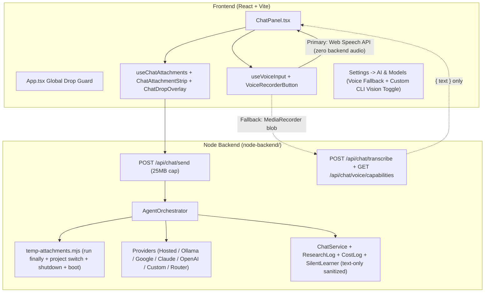

# PRD: Chat Multimodal Input (Temporary Image References & Voice-to-Text)

> **Feature**: `chat-multimodal-input`  
> **Target Version**: `v0.5.1` (bumped from `v0.4.5`)  
> **Branch**: `feat/chat-multimodal-input` (created from `main`)  
> **Status**: Draft — Ready for Product & UX Review  
> **Pipeline Stage**: Product/Design Agent -> UX Agent  

---

## 1. Executive Summary & Problem Statement

### 1.1 The Problem
ProductOS's AI Chat (`ChatPanel`) currently supports text prompts and `@file` / `#workflow` project references, creating two major friction points during real-world product research and synthesis:
1. **Visual Context Friction**: Product managers frequently need to ask questions about external visual artifacts—a screenshot of a competitor's pricing page, a slide from an executive deck, a UI mockup, or an error dialog—without polluting their structured Markdown workspace with imported binary files. Currently, users cannot attach, paste, or drag-and-drop transient images into chat. Moreover, in a browser-hosted web app, accidentally dragging an image onto the viewport risks replacing the browser tab with the dropped file.
2. **Typing Friction for Long Prompts & Ideation**: Capturing nuanced thoughts, interview takeaways, or feature brainstorms is often much faster by voice than typing. Without built-in speech-to-text dictation in the chat composer, users must switch to external OS/dictation tools or type long paragraphs manually.

### 1.2 The Solution & Privacy Posture
`v0.5.1` introduces two privacy-first input capabilities directly inside the ProductOS Chat window:
1. **Ephemeral Image References in Chat**:
   - Attach up to 4 temporary images per message via **Add Image button**, **Drag & Drop** directly onto the chat panel (in both `split` and `chat-focused` layouts), or **Clipboard Paste (`Cmd/Ctrl+V`)**.
   - Images remain **strictly ephemeral**: never imported into project folders, never indexed by `watcher.mjs` or Silent Learner, never written into `chats/*.md` or `research_log.md`, and deterministically deleted from temporary storage on turn completion/abort/error, **project switch**, **application shutdown/quit**, and **server startup orphan sweep**.
   - Chat history and the Research Log record only a compact, lightweight summary at the beginning of the interaction (attachment count and filenames, e.g. `2 attachments: slide-1.png, pricing.png`).
   - Built-in model vision feedback shows clear thumbnail previews, loading/pending indicators, **red error indicators** on confirmed non-vision models, and **amber warning indicators** on unverified Custom CLI providers (with a manual **"Supports Images (CLI)"** override in **Settings -> AI & Models**).
2. **Hybrid Voice-to-Text Dictation**:
   - A Microphone recording control in the chat composer converts speech to editable text right inside the chat input box (review/edit before sending), defaulting to the browser locale with a compact language switcher.
   - **Zero-Audio-Persistence Privacy Architecture**: Primary transcription uses the browser-native **Web Speech API** (`SpeechRecognition` / `webkitSpeechRecognition`), meaning **zero audio ever leaves the browser to the ProductOS backend**. For browsers without Web Speech API support (such as Firefox), a **configurable hybrid fallback** uses `MediaRecorder` -> `POST /api/chat/transcribe` routed through the user's choice of configured **OpenAI**, **Google AGY/Gemini**, or a detected local **Whisper CLI**—strictly in-memory/ephemeral with zero audio files saved.
   - If the user runs on an unsupported browser without OpenAI or AGY/Gemini (or local Whisper) configured, voice recording is clearly marked **Unsupported**, guiding the user to either switch to Chrome or configure AGY/OpenAI in **Settings -> AI & Models**.
   - Voice messages are stored in chat history and the Research Log purely as plain text (identical to typed messages, with no audio saved and no extra voice badge).

---

## 2. Target Personas & User Stories

| Persona | Primary Goal | Pain Point Solved |
| :--- | :--- | :--- |
| **Product Manager** | Ask questions about presentation slides, UI screenshots, or competitor mocks; dictate PRDs and feedback quickly. | Eliminates manual transcription of visual slides or tedious typing while keeping project folders clean of temporary screenshots. |
| **Privacy-Conscious Team Lead** | Keep sensitive product discussions, screenshots, and voice memos strictly local or under controlled API boundaries. | Ensures temporary screenshots never leak across projects or linger after app exit, and zero audio files are ever persisted on disk. |
| **Power User (Ollama / Custom CLI)** | Use local vision models or custom agent CLI wrappers with visual context. | Prevents silent failures by surfacing clear vision capability indicators and allowing explicit CLI capability overrides in Settings. |

### User Stories

#### US-1: Ephemeral Image Attachment (Add, Drag & Drop, Paste)
**As a** Product Manager,  
**I want** to add, drag-and-drop, or paste temporary screenshots/images into the Chat window (with or without accompanying text),  
**So that** the AI agent can analyze visual context like presentation slides or UI mockups without importing files into my project.

#### US-2: Safe Web Drag-and-Drop Isolation
**As a** ProductOS web user,  
**I want** dragging an image anywhere outside the Chat window (or while Chat is hidden) to never hijack or navigate away from my browser tab,  
**So that** accidental mis-drops never lose my active workspace state while existing upload zones (such as PPTX templates in Project Settings) continue working.

#### US-3: Thumbnail Previews, Pending State, and Vision Capability Indicators
**As a** user attaching images,  
**I want** to see thumbnail previews with pending/loading indicators while images process or wait in queue, plus clear indicators if the active model cannot analyze images or is an unverified Custom CLI,  
**So that** I know immediately whether my selected model supports visual analysis or needs a quick settings override.

#### US-4: Zero-Leakage Cleanup & Lightweight Log Indicator
**As a** security-minded user,  
**I want** temporary image files deleted immediately after the turn, upon switching projects, and upon quitting the app, while retaining only a simple count and filename indicator in the chat and Research Log,  
**So that** no binary data lingers or leaks between projects and my audit log notes that visual references were used.

#### US-5: Voice-to-Text Dictation with Edit-Before-Send
**As a** Product Manager,  
**I want** to record a voice message in the chat composer (defaulting to my browser language, with an optional language switcher), review/edit the transcribed text, and send it as a normal chat message,  
**So that** I can compose detailed prompts hands-free while ensuring only clean text is stored in chat history and the Research Log.

#### US-6: Hybrid STT Fallback & Unsupported Browser Guidance in Settings
**As a** user on Firefox or an environment without Web Speech API,  
**I want** to choose in **Settings -> AI & Models** whether voice fallback uses my configured OpenAI or AGY/Gemini provider (or local Whisper), or see a clear **Unsupported** indicator if neither is configured,  
**So that** voice behavior is predictable, transparent, and actionable.

#### US-7: Release v0.5.1 & Documentation Alignment
**As a** ProductOS user or maintainer,  
**I want** documentation across `docs/`, `CHANGELOG.md`, `CREDITS.md`, and `TELEMETRY.md` updated alongside a clean `v0.5.1` release,  
**So that** new multimodal and voice workflows and our privacy guarantees are accurately documented.

---

## 3. Scope Boundaries (In-Scope vs. Out-of-Scope)

| Category | In-Scope (`v0.5.1`) | Out-of-Scope (Future) |
| :--- | :--- | :--- |
| **Image Input** | Add-image button (`PNG, JPEG, WebP, GIF`), Drag & Drop onto `ChatPanel` (`split` & `chat-focused`), Clipboard paste (`Cmd/Ctrl+V`), multi-image staging strip (max 4 images, max 10 MB each, auto-downscale `> 2048px`), global drag/drop tab guard, empty-text send with default prompt | Permanent image import into project files, image cropping/annotation, dragging PDF/PPTX files into chat, re-displaying historical image pixels after session reload |
| **Vision Providers & Indicators** | Native multimodal payloads for `HostedAPIProvider` & `OllamaProvider`; ephemeral temp-file dispatch for `GoogleCliProvider` (`agy`/`gemini`), `ClaudeCodeProvider`, `OpenAiCliProvider` (`codex`), `CustomCliProvider`; `RoutedAIProvider` preservation; red non-vision error indicator; amber unverified Custom CLI warning + Settings `"Supports Images (CLI)"` manual toggle | Automatic vision-model fallback swapping, OCR pre-processing pipeline |
| **Ephemeral Cleanup & Logging** | Cleanup on turn `finally`, abort, error, **project switch**, **project delete**, **app quit/shutdown**, and **server startup** orphan sweep; lightweight attachment summary (`N attachment(s): file1.png, ...`) at beginning of chat user turn and Research Log entry; full base64 stripping before `ChatService`, `CostLog`, `SilentLearner`, and console logs | Cloud blob storage for chat media |
| **Voice-to-Text** | Hybrid STT (Web Speech API primary + `MediaRecorder` -> `/api/chat/transcribe` fallback using OpenAI / Google AGY-Gemini / local Whisper CLI), edit-before-send in textarea, browser-locale default + compact language switcher, **Settings -> AI & Models** fallback selector & unsupported browser/provider state (Firefox without OpenAI/AGY), plain-text-only logging | Saving or replaying audio files in chat/Research Log, voice badges in Research Log, AI audio/TTS output, continuous hands-free wake words |
| **Docs & Versioning** | Feature branch `feat/chat-multimodal-input` from `main`, version bump `0.4.5` -> `0.5.1`, updates to `docs/`, `CHANGELOG.md`, `CREDITS.md`, `TELEMETRY.md` | Marketing landing page video assets |

---

## 4. Testable Acceptance Criteria

### Feature 1: Temporary Image References
- **AC-1.1 (Composer Staging & Inputs):** `ChatPanel` provides an "Attach image" button (multi-select `.png,.jpg,.jpeg,.webp,.gif`), supports Drag & Drop directly over `ChatPanel` when `layoutMode` is `split` or `chat-focused`, and extracts pasted images from `ClipboardEvent.clipboardData`.
- **AC-1.2 (Global Web Tab Protection):** Dropping or dragging a file anywhere outside `ChatPanel` (or onto `ChatPanel` when `layoutMode === 'hidden'`) never triggers browser file navigation or tab takeover; existing drop zones such as the PPTX uploader in `ProjectSettings.tsx` continue functioning via event isolation (`stopPropagation`).
- **AC-1.3 (Thumbnail & Pending States):** Every staged image displays a thumbnail preview, filename, and remove (`X`) button. While client-side validation/resizing/encoding runs—or while a message containing images is queued (`messageQueue`) or awaiting an active turn—a visible loading/pending indicator renders on the thumbnail.
- **AC-1.4 (Empty-Text Send & Queue/Retry Preservation):** Users can send 1–4 staged images with an empty text box; the backend prompt receives a default instruction (`"Please analyze the attached image(s)."`). Queued messages (`messageQueue`), Socratic pre-checks, and failed-message retries (`handleRetry`) preserve attached images for the active session.
- **AC-1.5 (Vision Capability Indicators & Custom CLI Override):**
  - Confirmed non-vision models (e.g., text-only Ollama models) allow staging the image but render a **red error indicator** on the image stating the selected model does not support images and disable Send until the user switches models or removes the image.
  - Custom CLI providers render an **amber warning indicator** on staged images by default until the user enables **"Supports Images (CLI)"** in **Settings -> AI & Models -> Custom Model CLIs**, after which the warning clears whenever that custom CLI is active.
- **AC-1.6 (Deterministic Ephemeral Cleanup — Zero Leakage):**
  - API providers receive in-memory payloads and never write image files to disk.
  - CLI providers receive ephemeral files under `{projectPath}/.metadata/.tmp-chat/{runId}/` (or `os.tmpdir()/productos-chat-tmp/{runId}` when no project is selected), which is ignored by `watcher.mjs`, `getProjectFiles()`, and `SilentLearner`.
  - Temporary files are deleted unconditionally in `finally` (turn success, failure, abort), upon **switching active projects**, upon **deleting a project**, upon **application shutdown/quit** (`POST /api/system/shutdown`, `SIGINT`, `SIGTERM`), and upon **server startup** orphan sweep.
  - Frontend clears staged attachments, revokes object URLs, and cancels active voice recording immediately on project switch or unmount.
- **AC-1.7 (Chat & Research Log Representation):** Saved `chats/chat_*.md` files, `CostLog`, `SilentLearner`, and `research_log.md` never contain base64 image data or temp paths. Instead, the start of the chat message / Research Log entry records only the count and filenames (e.g., `**Attachments**: 2 attachments (slide-1.png, chart.png)`).

### Feature 2: Hybrid Voice-to-Text Input
- **AC-2.1 (Dictation & Edit-Before-Send):** Clicking the Microphone button starts speech capture with clear active recording feedback (pulsing indicator, elapsed timer, Stop & Cancel controls). Stopping appends/inserts the transcribed text into the chat `<Textarea>` so the user can review, edit, or combine it with staged images before clicking Send.
- **AC-2.2 (Locale & Language Switcher):** Dictation defaults to the browser's locale (`navigator.language || 'en-US'`). A compact language switcher allows choosing common dictation locales when room permits without crowding narrow split panels.
- **AC-2.3 (Text-Only Logging):** Transcribed voice messages are dispatched and stored in chat history and `research_log.md` as plain text only—no audio files are saved and no voice-specific badge is rendered.
- **AC-2.4 (Hybrid Fallback & Settings):**
  - In **Settings -> AI & Models**, a **Voice-to-Text** section shows browser Web Speech status and allows selecting the fallback transcription provider from configured providers (**OpenAI**, **Google AGY/Gemini**, or detected local **Whisper CLI**).
  - In browsers lacking Web Speech API (e.g., Firefox) where OpenAI/AGY/Whisper fallback is configured, clicking Record records via `MediaRecorder` and transcribes through `POST /api/chat/transcribe` strictly in memory (or ephemeral `os.tmpdir()` cleaned in `finally` for CLI) returning `{ text }` only.
  - In browsers lacking Web Speech API where neither OpenAI nor AGY/Gemini (nor local Whisper) is configured, both **Settings -> AI & Models** and the chat composer mark voice recording as **Unsupported**, disable recording, and explicitly suggest using Chrome or configuring either AGY or OpenAI.
- **AC-2.5 (Microphone Resource Cleanup):** Stopping, canceling, switching projects, or unmounting always aborts speech recognition and stops all `MediaStreamTrack` instances so browser recording indicators turn off immediately.

---

## 5. Edge Cases & Mitigations

| Edge Case | Expected Behavior |
| :--- | :--- |
| **Non-image file dropped or > 4 images or > 10 MB per file** | Reject non-images (client MIME + backend magic-byte check) and oversized/excess files with a non-destructive toast; keep existing valid staged images intact. |
| **Large retina screenshot (`> 2048px`)** | Client downscales longest edge to `<= 2048px` (preserving PNG transparency or re-encoding JPEG/WebP) while showing the thumbnail spinner (`processing`), cutting JSON size and token cost. |
| **Drop onto hidden ChatPanel (`opacity-0 pointer-events-none`)** | ChatPanel ignores drag/drop events when `layoutMode === 'hidden'`; `App.tsx` global drag guard prevents tab navigation. |
| **User switches projects while image staged or CLI agent running** | Frontend clears staged attachments, revokes object URLs, stops voice recording, and triggers project switch; backend aborts active run and runs `cleanupProjectTempAttachments(prevProjectId)` so zero temp files leak between projects. |
| **User quits app abruptly or server receives `SIGINT`/`SIGTERM`** | `POST /api/system/shutdown` and `gracefulShutdown` await `cleanupAllTempAttachments()` before `process.exit`; any hard crash (`SIGKILL`) leftovers are purged on next server boot. |
| **Base64 string triggers Silent Learner secret scanner** | `orchestrator.mjs` strips binary attachments and constructs clean text-only messages *before* passing to `SilentLearner.captureEvent()`, `CostLog`, `ChatService`, and `sanitizeEventPayloadForLog()`. |
| **Socratic Grill-Me triggers on an image-only/multimodal prompt** | Bypass Socratic interrogation automatically when attachments are present (or carry attachments cleanly through) so images are never silently dropped before reaching the agent. |
| **Firefox user with no OpenAI / AGY-Gemini / Whisper configured** | Voice capabilities endpoint reports zero available fallback providers; `useVoiceInput` enters `unsupported` state; UI disables Mic trigger and displays clear guidance to use Chrome or configure AGY or OpenAI. |
| **Microphone permission denied or hardware missing** | Transition cleanly to `error` state with actionable toast/inline hint; preserve any text already typed in the input box and release all media tracks. |

---

## 6. Dependencies & Technical Architecture Summary

---

## 7. Prioritized Implementation Slices

1. **Slice 1 — Backend Ephemeral Attachments & Provider Multimodal Adapters (P0)**:
   - `node-backend/lib/temp-attachments.mjs` (validation, magic-byte check, `.metadata/.tmp-chat` materialization, `finally` + project-switch + shutdown + boot cleanup).
   - Provider updates (`base`, `hosted`, `ollama`, `google`, `claude`, `openai`, `custom`, `model-router`).
   - `orchestrator.mjs`, `chat.mjs`, `research-log.mjs`, `server.mjs` (25 MB cap, cleanup hooks, attachment header logging, base64 stripping).
2. **Slice 2 — Frontend Image Staging, Global Drop Guard & Vision Indicators (P0)**:
   - `src/App.tsx` global drag guard + `ProjectSettings.tsx` `stopPropagation` verification.
   - `useChatAttachments.ts`, `ChatAttachmentStrip.tsx`, `ChatDropOverlay.tsx`, `visionCapabilities.ts`.
   - `ChatPanel.tsx` Add button, drag-drop, clipboard paste, empty-text send, queue/retry attachment support, project-switch cleanup.
   - `ProviderSettings.tsx` `"Supports Images (CLI)"` manual toggle on Custom Model CLIs.
3. **Slice 3 — Hybrid Voice-to-Text, Language Switcher & AI & Models Settings (P0/P1)**:
   - `node-backend/lib/transcription.mjs` + `/api/chat/voice/capabilities` & `/api/chat/transcribe`.
   - `useVoiceInput.ts`, `VoiceRecorderButton.tsx` (recording bar, timer, browser-locale default, language switcher, Firefox unsupported state).
   - `ModelSettings.tsx` **Voice-to-Text** fallback section + unsupported browser notice.
4. **Slice 4 — Research Log UI, Automated Tests, Docs & v0.5.1 Release (P0)**:
   - `ResearchLog.tsx` attachment summary badge/line (no voice badge).
   - Unit/integration tests (`node --test`) + Playwright E2E suite (`e2e/chat-multimodal-input.spec.ts`).
   - Full documentation update across `docs/`, `CHANGELOG.md`, `CREDITS.md`, `TELEMETRY.md`, and version bump to `0.5.1`.

---

## 8. API & Contract Assumptions (FE <-> BE)

- **`POST /api/chat/send` (and `/api/chat`)**: Request JSON limit increased to `25 MB`. Latest user `ChatMessage` may include `attachments?: ChatImageAttachmentPayload[]`.
- **`GET /api/chat/voice/capabilities`**: Returns `{ fallbackProviders: { openAi: boolean; gemini: boolean; localWhisper: boolean }, availableProviders: string[], configuredFallback: string }` so the frontend knows immediately whether hybrid fallback exists if Web Speech API is absent.
- **`POST /api/chat/transcribe`**: Accepts `{ audioBase64, mimeType, language?, preferredProvider? }` (`20 MB` cap); returns `{ text, provider }` without persisting audio.
- **`GlobalSettings` additions** (strictly optional, backward-compatible):
  - `customClis[i].supportsImages?: boolean`
  - `voiceInput?: { fallbackProvider?: 'auto' | 'openAi' | 'gemini' | 'localWhisper' | 'none'; language?: string }`
- **`ResearchLogEntry` addition**: `attachments?: string[]` / `attachmentSummary?: string` parsed from `**Attachments**: ...` in `research_log.md`.

---

## 9. Documentation & Changelog Plan (What Changed & What to Update)

Per explicit product requirement, the `v0.5.1` release MUST update user documentation to highlight multimodal chat workflows and reinforce ProductOS's **local-first privacy messaging**:

| Document | Changes Required for `v0.5.1` |
| :--- | :--- |
| `docs/README.md` | Add ephemeral image analysis and voice-to-text dictation to **Key Concepts**; expand **Security & Privacy** with zero-audio-persistence (browser Web Speech primary) and non-persisted temporary image lifecycle guarantees. |
| `docs/02-main-components.md` | Update the **AI Chat** component overview with visual reference support (Add / Drag & Drop / Paste) and voice dictation capabilities. |
| `docs/04-projects-guide.md` | Document how to attach, drag-drop, or paste temporary screenshots (including image-only prompts), explain vision error/warning indicators, document voice recording + edit-before-send + language switcher, and show how Research Log records only attachment counts/filenames and plain text. |
| `docs/07-settings-guide.md` | Document **Settings -> AI & Models** additions: (1) **Custom Model CLIs -> Supports Images (CLI)** toggle for clearing unverified warnings; (2) **Voice-to-Text Fallback** provider selector (OpenAI / AGY-Gemini / local Whisper) and Firefox unsupported browser guidance. |
| `docs/08-data-portability.md` | Add an **Ephemeral Media & Privacy Guarantees** subsection explaining why temporary chat images and voice recordings are excluded from project exports/backups and purged on turn completion, project switch, and app quit. |
| `docs/13-silent-learner.md` | Document that `.metadata/.tmp-chat/` is excluded from file watching and Silent Learner capture, and that Silent Learner inspects sanitized text-only messages rather than raw base64 payloads. |
| `TELEMETRY.md` | Document any newly added allowlisted non-PII events (e.g., `chat.image_attached`, `chat.voice_dictated`) with explicit note that filenames, image contents, and transcripts are never collected. |
| `CHANGELOG.md` | Add `## [0.5.1]` release entry detailing image references, hybrid voice-to-text, privacy/cleanup lifecycle, Settings enhancements, and bug fixes. |
| `CREDITS.md` | Regenerate / bump version header to `0.5.1`. |

---

## Standard Handoff Contract

- **Summary**: Defined the `v0.5.1` PRD for `chat-multimodal-input` covering temporary chat image references (add/drag-drop/paste, global tab-takeover protection, thumbnails/pending state, non-vision error & Custom CLI warning/toggle, deterministic cleanup, lightweight Research Log summary) and hybrid voice-to-text dictation (Web Speech primary + OpenAI/AGY-Gemini/Whisper fallback, edit-before-send, language switcher, Firefox unsupported guidance, text-only logging), plus a full Documentation Plan.
- **Decisions made**: Ephemeral `.metadata/.tmp-chat/` storage for CLI providers only; zero-persistence text-only chat/Research Log design; hybrid STT defaulting to browser locale; manual `supportsImages` opt-in on Custom Model CLIs; branch `feat/chat-multimodal-input` from `main` targeting `v0.5.1`.
- **Open risks**: Browser Web Speech API behavior varies across Chromium/Safari/Electron wrappers and requires explicit network connectivity to vendor speech services in Chrome (mitigated by clear privacy notice and backend fallback); some Ollama vision models require `/api/show` inspection vs name heuristics.
- **Artifacts produced**: `docs/features/chat-multimodal-input/prd.md`.
- **Handoff to next agent**: UX Agent to produce `ux-spec.md` detailing exact flows, thumbnail badges (pending/warning/error), drag-drop states, voice recorder bar, language selector, Settings controls, accessibility specs, and UI copy.
- **Blockers**: None (awaiting user review of pipeline specs before starting implementation).
