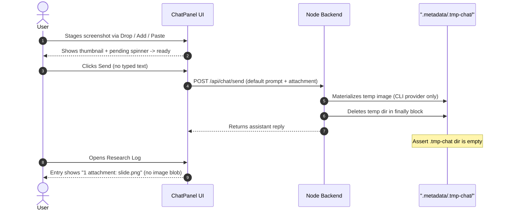

# QA Test Strategy: Chat Multimodal Input (v0.5.1)

> **Feature**: `chat-multimodal-input`  
> **Target Version**: `v0.5.1`  
> **Status**: Draft — Ready for Review  
> **Pipeline Stage**: QA Strategy Agent -> Unit Test & E2E Test Agents  
> **Reference Specs**: [prd.md](./prd.md) &bull; [ux-spec.md](./ux-spec.md) &bull; [frontend-plan.md](./frontend-plan.md) &bull; [backend-plan.md](./backend-plan.md)  

---

## 1. Executive Summary & Quality Goals

This QA Strategy defines the verification plan for **Chat Multimodal Input (`v0.5.1`)**, guaranteeing data privacy (zero lingering temp files or cross-project leakage, zero audio persistence), safe web drag-and-drop isolation, accurate model vision capability feedback, reliable hybrid speech-to-text, and zero regression across existing ProductOS workflows.

---

## 2. Risk-Based Test Matrix

| Priority | Risk Category | Potential Failure Mode | Test Strategy |
| :--- | :--- | :--- | :--- |
| **P0 (Critical)** | **Cross-Project & Post-Quit Data Leakage** | Temporary images persist in `.metadata/.tmp-chat/` or `os.tmpdir()` after turn failure/abort, project switch, or app quit. | Backend unit/integration tests for all 4 cleanup triggers (turn `finally`, project switch/delete, app shutdown, startup sweep) + Playwright project-switch test. |
| **P0 (Critical)** | **Browser Tab Takeover on Mis-Drop** | Dropping an image outside `ChatPanel` or while `ChatPanel` is hidden replaces the app URL with `file://` or image preview. | Playwright drag-and-drop assertions on Editor, Sidebar, and Hidden-Chat view + regression check on `ProjectSettings` PPTX dropzone. |
| **P0 (Critical)** | **Binary / Audio Persistence Leakage** | Base64 images or audio blobs written to `chats/*.md`, `research_log.md`, `cost_log.json`, console logs, or Silent Learner `memory.db`. | Unit assertions verifying sanitized payloads across `ChatService`, `ResearchLog`, `CostLog`, `SilentLearner`, and `sanitizeEventPayloadForLog`. |
| **P0 (Critical)** | **Non-Vision & Custom CLI Feedback** | Confirmed non-vision models allow broken image sends, or Custom CLI warning never clears after user enables `"Supports Images (CLI)"`. | Unit tests for `visionCapabilities.ts` + E2E tests toggling Custom CLI support in **Settings -> AI & Models**. |
| **P0 (Critical)** | **Unsupported Browser STT UX (Firefox)** | Firefox users without OpenAI / AGY-Gemini configured get broken recording or silent failure instead of clear Unsupported guidance. | E2E tests removing `SpeechRecognition` with and without OpenAI/AGY secrets, asserting Settings banner and Chat Mic state. |
| **P1 (High)** | **Provider Payload Fidelity** | Hosted API, Ollama, Codex (`--image`), Claude, Google/Antigravity, Custom CLI, or Model Router drop or misformat image payloads. | Unit tests per provider adapter and `RoutedAIProvider` fallback/redaction paths. |
| **P1 (High)** | **Queue, Retry & Empty-Text Send** | Queued messages or failed-message retries lose attachments, or empty text blocks image-only prompts. | Component/E2E tests verifying queued thumbnails, retry preservation, and default prompt injection. |
| **P1 (High)** | **Microphone Cleanup & Locale Handling** | Stopped/canceled/unmounted recording leaves browser mic track active, or locale ignores browser default / switcher. | Hook tests verifying `MediaStreamTrack.stop()` and `recognition.abort()` on stop, cancel, switch, and unmount. |
| **P2 (Medium)** | **Image Size / Resize & Narrow Viewport** | Large retina screenshots (`> 2048px`) hit 10 MB limits or narrow `split` chat widths overlap composer icons. | Client resize unit test + responsive Playwright viewport checks. |

---

## 3. Functional Test Scenarios

### 3.1 Ephemeral Image Lifecycle & Privacy Flow

### 3.2 Core Functional Journeys
1. **Add / Drop / Paste Staging**: Attach via file picker, drag-drop in both `split` and `chat-focused` modes, and clipboard paste; verify thumbnails, pending spinner, and removal (`X`).
2. **Global Drag Isolation**: Drag/drop onto Editor and Sidebar -> URL stays on app, zero images staged; drag/drop onto hidden Chat -> blocked; drag/drop `.pptx` onto `ProjectSettings` -> succeeds.
3. **Model Vision States**:
   - Select text-only Ollama model (`llama3`) -> staged image shows red error indicator and Send is disabled.
   - Select Custom CLI (unverified) -> staged image shows amber warning; enable `"Supports Images (CLI)"` in Settings -> warning disappears.
4. **Cleanup Matrix**: Stage or run CLI turn -> switch projects -> verify prior project temp dir cleaned and staged UI cleared; quit/shutdown -> verify all temp dirs cleaned; simulate stale orphan dir -> verify boot sweep deletes it.
5. **Hybrid Voice-to-Text**:
   - Web Speech primary: record -> change locale -> stop -> edit transcript in textarea -> send -> verify plain text in chat & Research Log.
   - Fallback mode (no Web Speech, OpenAI or AGY configured): record via `MediaRecorder` -> `/api/chat/transcribe` -> edit text -> send -> verify zero audio files on disk.
   - Unsupported browser (no Web Speech, no fallback): Mic disabled & marked Unsupported with Chrome / AGY / OpenAI suggestion.

---

## 4. Regression Scope

Must remain green with zero behavioral breakage:
- Standard text chat streaming (`chat-delta` SSE) and `Stop Thinking` cancellation.
- `@file` and `#workflow` suggestions & context injection.
- Socratic Grill-Me interrogation (`SocraticGrillCard`) for text-only artifact prompts.
- Inline comment resolution (`RevisionApprovalCard`).
- `ResearchLog` session resume (`chat:load-session`).
- `ProjectSettings` `.pptx` template drag-and-drop upload.
- `SilentLearner` secret scanning & redaction workflow on real secrets in text prompts.

---

## 5. Negative & Pathological Cases

- Spoofed image file (`evil.exe` renamed to `fake.png` with non-PNG magic bytes) -> HTTP `400` from `temp-attachments.mjs`.
- Path traversal in filename (`../../etc/passwd.png`) -> sanitized to basename, never escapes temp directory.
- `> 4` images dropped or `> 10 MB` file -> rejected cleanly with toast.
- Server JSON payload `> 25 MB` -> HTTP `413` from `readJson`.
- Invalid audio MIME or `> 15 MB` audio on `/api/chat/transcribe` -> HTTP `400`.
- Transcription requested when no STT provider is configured -> HTTP `503` (`NO_STT_PROVIDER`).
- Clicking Record then immediately clicking Cancel or switching projects -> zero unhandled promise rejections and mic tracks stopped.

---

## 6. Release Exit Criteria (`v0.5.1`)

- All P0 and P1 automated tests passing (`npm test`, `npm run test:e2e`, `npm run build`).
- Zero lingering files in `.metadata/.tmp-chat/` or `os.tmpdir()/productos-chat-tmp/` after E2E runs.
- `SilentLearner` and `CostLog` tests prove base64 payloads never inflate costs or trigger false-positive secret pauses.
- All user docs in `docs/`, `CHANGELOG.md`, `CREDITS.md`, and `TELEMETRY.md` updated and verified.

---

## Standard Handoff Contract

- **Summary**: Defined P0/P1/P2 risk matrix, functional test scenarios, regression scope, negative/security test cases, and release exit criteria for `chat-multimodal-input` (`v0.5.1`).
- **Decisions made**: Elevated cross-project/shutdown temp-file cleanup, global drop guard, base64 sanitization, and Firefox unsupported voice UX to P0 release gates.
- **Open risks**: Real microphone hardware is unavailable in headless Ubuntu CI runners, requiring deterministic Playwright init-script mocks for `SpeechRecognition` and `MediaRecorder`.
- **Artifacts produced**: `docs/features/chat-multimodal-input/qa-plan.md`.
- **Handoff to next agent**: Unit Test Agent (`unit-test-plan.md`) and E2E Test Agent (`e2e-plan.md`) to specify concrete test suites and selectors.
- **Blockers**: None.
