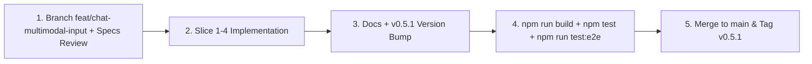

# Release & Deployment Plan: Chat Multimodal Input (v0.5.1)

> **Feature**: `chat-multimodal-input`  
> **Target Version**: `v0.5.1` (bumped from `v0.4.5`)  
> **Branch**: `feat/chat-multimodal-input` (from `main`)  
> **Status**: Draft — Ready for Review  
> **Pipeline Stage**: DevOps Agent -> Implementation & Release Readiness  
> **Reference Specs**: [prd.md](./prd.md) &bull; [qa-plan.md](./qa-plan.md) &bull; [e2e-plan.md](./e2e-plan.md)  

---

## 1. Executive Summary & Versioning Plan

This release plan governs the branching, version bump to **`0.5.1`**, CI/CD verification, documentation synchronization, rollout, and rollback strategy for **Chat Multimodal Input (`v0.5.1`)**.

### Version Bump Targets (`0.4.5` -> `0.5.1`)
- `package.json` (`"version": "0.5.1"`)
- `package-lock.json` (root `"version": "0.5.1"` and `packages[""].version`)
- `CHANGELOG.md` (`## [0.5.1]` release notes)
- `CREDITS.md` (regenerate with `npm run generate-credits` after `package.json` update)
- `node-backend/tests/updates.test.mjs` (verify version test fixtures/assertions stay accurate)

---

## 2. CI/CD & Environment Updates

### 2.1 CI Workflow Compatibility (`.github/workflows/test.yml`)
- **Build check**: `npm run build` (`tsc && vite build`) — verifies zero TypeScript strict errors and bundle build cleanliness.
- **Backend unit/integration tests**: `npm test` — automatically executes `node-backend/tests/*.test.mjs` and `tests/*.test.mjs` including `temp-attachments.test.mjs`, `multimodal-providers.test.mjs`, `transcription.test.mjs`, `research-log.test.mjs`, and `vision-capabilities.unit.test.mjs`.
- **Playwright E2E tests**: `npm run test:e2e` on Ubuntu CI — runs `e2e/chat-multimodal-input.spec.ts` using deterministic browser API stubs (no microphone hardware required).
- **Dependencies**: **Zero new npm dependencies** required (reuses browser `Canvas`, `Web Speech API`, `MediaRecorder`, and Node 20+ native `FormData`/`Blob` + `fetch`).

### 2.2 Environment / Config Changes
- No mandatory new environment variables.
- Existing `settings.json` schemas remain backward-compatible; new optional keys (`customClis[].supportsImages`, `voiceInput.fallbackProvider`, `voiceInput.language`) use safe defaults (`false` / `'auto'` / browser locale).
- Existing CSP in `index.html` requires no relaxation because fallback transcription calls only the local Node backend (`http://127.0.0.1:*` / `http://localhost:*`).

---

## 3. Feature Rollout & Privacy Verification

### Documentation Update Checklist (Mandatory Before Merge)
- [ ] `docs/README.md` — Add temporary image references & voice dictation to Key Concepts and Privacy section.
- [ ] `docs/02-main-components.md` — Update AI Chat description.
- [ ] `docs/04-projects-guide.md` — Document Add/Drop/Paste image workflow, empty-text send, model error/warning indicators, voice edit-before-send + language switcher, and Research Log attachment summary.
- [ ] `docs/07-settings-guide.md` — Document Settings -> AI & Models: Custom CLI `"Supports Images (CLI)"` toggle + Voice-to-Text fallback selector & Firefox unsupported guidance.
- [ ] `docs/08-data-portability.md` — Document ephemeral media exclusion and deterministic cleanup on turn end, project switch, and app quit.
- [ ] `docs/13-silent-learner.md` — Document `.metadata/.tmp-chat/` exclusion and sanitized text-only Silent Learner capture.
- [ ] `TELEMETRY.md` (plus `src/lib/telemetryCatalog.ts` & `node-backend/lib/telemetry/catalog.mjs`) — Add allowlisted non-PII events (`chat.image_attached`, `chat.voice_dictated`) with no PII/content fields.
- [ ] `CHANGELOG.md` & `CREDITS.md` — Final `v0.5.1` entries.

---

## 4. Rollback Plan

Because `v0.5.1` introduces no destructive migrations to project directories, `research_log.md` format, `chats/*.md` format, or `settings.json`:
1. **Code Rollback**: Reverting the merge commit (or resetting `main` prior to `feat/chat-multimodal-input`) restores `v0.4.5` cleanly with zero data-migration steps.
2. **Orphan Temp Cleanup**: Any leftover `.metadata/.tmp-chat/` directories are safe to delete (`rm -rf`) and are automatically swept by `v0.5.1` startup/shutdown routines.
3. **Settings Compatibility**: Optional keys (`voiceInput`, `supportsImages`) are safely ignored if downgraded to `v0.4.5`.

---

## 5. Post-Release Monitoring Checklist

- Verify `GET /api/health` reports `0.5.1-node`.
- Monitor telemetry (when enabled by user) for `agent.run.failed` spikes linked to multimodal providers or `NO_STT_PROVIDER` errors.
- Spot-check local project folders after multimodal chat sessions, project switches, and app quits to verify `.metadata/.tmp-chat/` remains clean and `research_log.md` logs only compact count + filename headers and plain-text transcripts.

---

## Standard Handoff Contract

- **Summary**: Completed release plan for `v0.5.1` covering branch strategy (`feat/chat-multimodal-input`), version bump targets, zero-new-dependency CI/CD checks, mandatory documentation checklist, clean rollback path, and post-release monitoring.
- **Decisions made**: Zero breaking schema migrations; zero new npm packages; strict documentation sync bundled inside the `v0.5.1` PR before merge.
- **Open risks**: Ensure `node-backend/tests/updates.test.mjs` and `package-lock.json` remain consistent when bumping `package.json` from `0.4.5` to `0.5.1`.
- **Artifacts produced**: `docs/features/chat-multimodal-input/release-plan.md`.
- **Handoff to next agent**: All 8 Stage-Gate planning documents are complete and ready for **User / Product Review** prior to beginning Slice 1 implementation.
- **Blockers**: Awaiting user review & approval to begin implementation.
