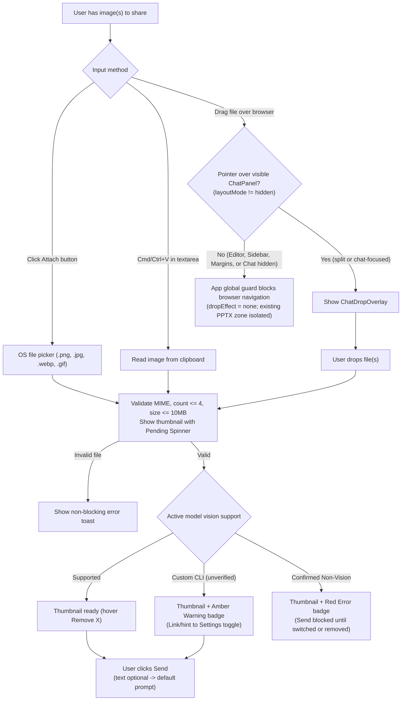

# UX Specification: Chat Multimodal Input (v0.5.1)

> **Feature**: `chat-multimodal-input`  
> **Target Version**: `v0.5.1`  
> **Status**: Draft — Ready for Review  
> **Pipeline Stage**: UX Agent -> Frontend & Backend Agents  
> **Reference PRD**: [prd.md](./prd.md)  

---

## 1. Executive Summary & Design Objectives

This specification defines the user flows, visual states, component annotations, accessibility standards, and exact UI copy for adding **temporary image references** and **voice-to-text dictation** to `ChatPanel`, plus supporting controls in `ResearchLog` and **Settings -> AI & Models**.

### Primary UX Objectives
1. **Zero Friction Visual Context**: Attaching a screenshot takes a single click, drag-drop, or `Cmd/Ctrl+V` paste—without cluttering the workspace or navigating away from the browser tab on mis-drops.
2. **Immediate Capability Transparency**: Users immediately see thumbnail previews, loading/pending states, and whether the current model supports images (error badge on confirmed non-vision models; dismissible warning on unverified Custom CLIs).
3. **Calm, Editable Voice Dictation**: Dictation inserts text directly into the familiar composer so users can review, edit, or combine voice + images before sending.
4. **Clear Privacy & Browser Compatibility Messaging**: Users understand when audio stays local/browser-native, when a fallback provider is used, and exactly what to do if their browser (e.g., Firefox) lacks both Web Speech API and a configured fallback.

---

## 2. Primary & Alternate User Flows

### 2.1 Image Attachment, Drag-Drop & Guard Flow



### 2.2 Hybrid Voice-to-Text Dictation Flow

```mermaid
sequenceDiagram
    autonumber
    actor User
    participant UI as ChatPanel Composer
    participant Hook as useVoiceInput
    participant WebSpeech as Browser Web Speech API
    participant Backend as /api/chat/transcribe

    User->>UI: Clicks Mic button
    alt Web Speech API unsupported AND no fallback configured (e.g., Firefox)
        Hook-->>UI: state = unsupported
        UI-->>User: Mic marked Unsupported; tooltip/banner suggests Chrome or configuring AGY/OpenAI
    else Web Speech API available (Chrome / Edge / Safari)
        Hook->>WebSpeech: start({ lang: selectedLocale || navigator.language })
        UI-->>User: Inline Recording Bar (pulsing red dot, 0:04 timer, Stop, Cancel, interim preview)
        User->>UI: Clicks Stop
        WebSpeech-->>Hook: Final transcript text
        Hook-->>UI: Appends transcript into chat textarea (focus preserved)
        User->>UI: Reviews/edits text (optional: attaches image) & clicks Send
    else Web Speech unavailable, fallback configured (OpenAI / AGY-Gemini / Whisper)
        Hook->>UI: MediaRecorder starts capture
        User->>UI: Clicks Stop
        UI-->>User: Shows Transcribing spinner on mic bar
        Hook->>Backend: POST /api/chat/transcribe (in-memory audio)
        Backend-->>Hook: Returns { text } only (no audio saved)
        Hook-->>UI: Inserts transcript into chat textarea for edit-before-send
    end
```

---

## 3. Component & Screen States Matrix

### 3.1 Chat Composer Attachment Strip (`ChatAttachmentStrip`)

| State | Visual Presentation | User Actions |
| :--- | :--- | :--- |
| **Empty** | Strip hidden (`0px` height); composer unchanged. | Click Attach Image icon, Paste, or Drag over chat. |
| **Processing (`pending`)** | `56x56` rounded thumbnail tile with subtle dim overlay + centered spinner (`Loader2`) while client validates/downscales (`> 2048px`). | Wait (~50–250ms) or click `X` to cancel. |
| **Ready (Vision Supported)** | Crisp thumbnail preview + truncated filename/size tooltip + top-right `X` remove button on hover/focus. | Remove (`X`), add more (up to 4), type text or send immediately. |
| **Queued / Sending Pending** | Attached thumbnails inside the queued bubble or active user bubble show a subtle `Pending` / spinner badge until the turn dispatches and finishes; once sent, history retains only the text attachment summary. | Cancel/stop run if needed; retrying failed messages keeps attachments. |
| **Warning (`unverified` Custom CLI)** | Thumbnail displays an **amber triangle warning badge** (`AlertTriangle`) on the bottom-right corner. Hovering/focusing shows tooltip: *"Image support for this custom CLI is unverified. Confirm in Settings -> AI & Models if your CLI accepts images."* | Send anyway, remove image, or enable **"Supports Images (CLI)"** in Settings. |
| **Error (`unsupported` Non-Vision Model)** | Thumbnail has a **red border & error badge** (`AlertCircle`) with inline helper banner below strip: *"Selected model (`llama3`) does not support image analysis. Switch to a vision-capable model or remove image(s)."* **Send button is disabled.** | Switch provider/model or click `X` to remove image(s). |

### 3.2 Drag-and-Drop Overlay (`ChatDropOverlay`)
- Shown over the entire `ChatPanel` container (both `split` side panel and `chat-focused` centered card) whenever dragging files over `ChatPanel` and `layoutMode !== 'hidden'`.
- Styling: Dashed primary border (`border-2 border-dashed border-primary`), translucent backdrop (`bg-background/85 backdrop-blur-sm`), centered image icon + copy (`Drop images to reference in chat — Temporary only, not imported into project`).
- **Hidden / Outside Chat**: When `layoutMode === 'hidden'` (`pointer-events-none`), `ChatPanel` ignores all drag events. `App.tsx` intercepts `dragover`/`drop` on `window` and shows `dropEffect = 'none'` so the browser never navigates to `file://` or blob image previews.
- **ProjectSettings Exception**: `ProjectSettings.tsx` PPTX sample deck drop zone stops event propagation so its existing drag-and-drop continues working seamlessly.

### 3.3 Voice Recorder & Language Switcher (`VoiceRecorderButton`)

| State | Visual Presentation | Behavior |
| :--- | :--- | :--- |
| **Idle (Supported)** | Compact `Mic` icon button inside composer toolbar (left of Send) + subtle locale chip (`EN`, `HE`, etc., defaulting to `navigator.language`). | Click `Mic` to start; click locale chip to switch dictation language. |
| **Unsupported (e.g., Firefox w/o Fallback)** | `MicOff` / muted `Mic` button with subtle error/info dot and `aria-disabled="true"`. Clicking or hovering opens a concise popover: *"Voice recording isn't supported in this browser without a configured transcription fallback. Use Chrome, or configure Google (AGY/Gemini) or OpenAI in Settings -> AI & Models."* | Direct button/link opens **Settings -> AI & Models**. |
| **Requesting Permission** | Mic button shows brief spinner while `getUserMedia` / speech permission resolves. | Cancels cleanly if user denies. |
| **Recording** | Replaces or expands compactly above/within composer toolbar as an active **Recording Pill**: pulsing red dot, monospace elapsed timer (`00:12`), live interim transcript preview (muted italic snippet when using Web Speech), **Cancel** (`Trash/X`), and **Done/Stop** (`Square` / `Check`) button. | Clicking **Done/Stop** finalizes text and inserts into `<Textarea>` at cursor/end and focuses textarea. Clicking **Cancel** discards without altering draft text. |
| **Transcribing (Fallback Mode)** | Recording pill switches to `Transcribing audio...` with `Loader2` spinner until `/api/chat/transcribe` responds. | User can cancel in-flight request; on response, text is placed in `<Textarea>` ready for editing. |
| **Mic Error / Permission Denied** | Non-destructive toast + brief inline error hint explaining how to grant browser mic permission; existing typed text preserved. | Retry anytime. |

### 3.4 Settings -> AI & Models Additions
1. **Custom Model CLIs (`ProviderSettings.tsx`)**:
   - Inside each Custom CLI card (below "Provider Location"), add a switch row:
     - Label: **Supports Images (CLI)**
     - Helper text: *"Enable if this custom CLI can read image paths passed in prompts. Removes the unverified warning badge in Chat."*
2. **Voice-to-Text Section (`ModelSettings.tsx`)**:
   - Card header: **Voice-to-Text (Speech Input)** with privacy shield badge: *"Uses browser speech recognition by default (no audio sent to ProductOS backend)."*
   - Browser Compatibility & Status banner:
     - On Chrome/Edge/Safari: *"Browser Web Speech API detected (Primary). Configure an optional cloud/local fallback below."*
     - On Firefox with configured fallback: *"Browser Web Speech API unavailable — using [Selected Fallback] in-memory transcription."*
     - On Firefox with **no** OpenAI or AGY/Gemini (or Whisper) configured: Amber/Red alert banner marked **Unsupported**: *"Voice recording in Chat is unsupported on this browser because no fallback transcription provider is configured. Switch to Chrome or configure OpenAI or Google (AGY/Gemini) above."*
   - **Fallback Transcription Provider** `<Select>`:
     - Options: `Auto (OpenAI -> Google AGY/Gemini -> Local Whisper)`, `OpenAI (Whisper / gpt-4o-mini-transcribe)`, `Google (AGY / Gemini)`, `Local Whisper CLI`, `Disabled (Browser Only)`.
     - Providers that are not configured appear clearly labeled `(Not configured)` and disabled unless active.

### 3.5 Chat History & Research Log Presentation
- **Chat Message Bubble (User)**:
  - During the active live session, displays a clean compact header tag/row above the user's message text showing attachment count + filenames (and temporary thumbnail strip only while active in memory before reload).
  - After saving/reloading from `chats/chat_*.md`, renders the clean markdown summary at the top of the user message (e.g., `2 attachments: slide-1.png, chart.png`) followed by the prompt text.
- **Research Log Timeline (`ResearchLog.tsx`)**:
  - Displays a concise muted pill/line at the top of the interaction entry body when attachments were present: e.g. `2 attachments: slide-1.png, chart.png`.
  - Voice-dictated turns look **100% identical** to typed turns (plain text only, no microphone/voice badge).

---

## 4. Accessibility Requirements (WCAG 2.1 AA)

- **Keyboard Navigation**:
  - Attach Image button, Remove thumbnail (`X`), Mic button, Language selector, Recording Stop, and Recording Cancel are all focusable `<button>` elements reachable via `Tab` with visible `:focus-visible` rings.
  - Pressing `Escape` while recording cancels recording (or closes the language dropdown) cleanly without closing the chat panel.
- **ARIA & Screen Readers**:
  - Mic button uses `aria-pressed={isRecording}`, descriptive `aria-label` (`"Start voice recording"` / `"Stop voice recording"`), and `aria-describedby` when unsupported.
  - Live status region (`aria-live="polite"`) announces `"Attached 2 images"`, `"Recording started"`, `"Transcription inserted into message"`, and `"Model does not support images"`.
- **Non-Color Redundancy**:
  - Non-vision errors and custom CLI warnings pair distinct colors (`red` vs `amber`) with distinct icons (`AlertCircle` vs `AlertTriangle`) and explicit text tooltips/`aria-label`s.
- **Viewport Responsiveness (`split` vs `chat-focused`)**:
  - In narrow `split` sidebar widths (`~360px`), composer controls stay on a single clean row: `[Attach Image] [Mic + Locale] ... [Send]`, wrapping the staged thumbnail strip horizontally with smooth scroll (`overflow-x-auto`) rather than squishing the textarea.

---

## 5. Exact UI Copy Draft

- **Drop Overlay Title**: `Drop images to reference in chat`
- **Drop Overlay Subtitle**: `Temporary context only — images are not imported into your project.`
- **Default Empty-Text Image Prompt**: `Please analyze the attached image(s).`
- **Non-Vision Error Indicator**: `Selected model does not support images. Switch models or remove the image to send.`
- **Custom CLI Unverified Warning**: `Image support for this custom CLI is unverified. Confirm "Supports Images (CLI)" in Settings -> AI & Models if supported.`
- **Unsupported Voice Tooltip / Settings Banner**: `Voice recording is unsupported in this browser without a transcription fallback. Use Chrome, or configure Google (AGY/Gemini) or OpenAI in Settings -> AI & Models.`
- **Chat & Research Log Attachment Summary**: `1 attachment: slide-1.png` / `2 attachments: slide-1.png, diagram.png`

---

## 6. Handoff Annotations for Frontend Agent

- Keep `ChatPanel.tsx` modular: extract staging state, drop overlay, attachment strip, voice hook, and recorder button into dedicated components/hooks.
- Always check `layoutMode !== 'hidden'` before responding to drag events on `ChatPanel` because `MainPanel.tsx` keeps `ChatPanel` mounted in the DOM when hidden.
- Always clear staged attachments (`URL.revokeObjectURL`) and terminate active voice recording inside a `useEffect` watching `activeProject?.id`.

---

## Standard Handoff Contract

- **Summary**: Completed full UX specification covering image staging states (pending spinner, red non-vision error, amber unverified custom CLI warning), global browser drop isolation, hybrid voice dictation with edit-before-send + locale switcher, Firefox unsupported state, Settings UI additions, WCAG 2.1 AA accessibility rules, and exact UI copy.
- **Decisions made**: Compact single-row composer controls that fit narrow `split` panels; inline recording pill with Stop/Cancel + interim text; edit-before-send insertion rather than auto-send; explicit visual differentiation between unverified warning (amber) and confirmed non-vision error (red, send-blocked).
- **Open risks**: Very narrow split-panel widths (`< 340px`) could clip long locale labels—mitigated by showing short ISO tags (`EN`, `HE`, `ES`) inside the compact trigger and full names inside the dropdown menu.
- **Artifacts produced**: `docs/features/chat-multimodal-input/ux-spec.md`.
- **Handoff to next agent**: Frontend & Backend Agents to map component/hook architecture (`frontend-plan.md`) and API/provider/cleanup architecture (`backend-plan.md`).
- **Blockers**: None.
